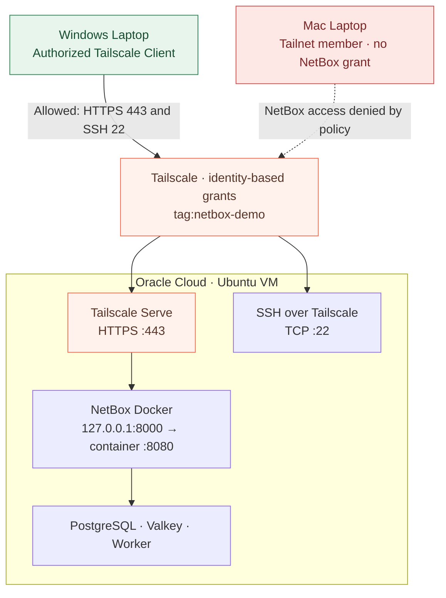

# Tailscale + NetBox: Private HTTPS Zero-Trust Demo

This portfolio project documents a working, tailnet-only NetBox deployment on an Oracle Cloud Ubuntu ARM64 VM. It uses the official [netbox-docker](https://github.com/netbox-community/netbox-docker) Compose stack and **Tailscale Serve** for private HTTPS.

## Architecture

The [full network diagram and traffic-flow walkthrough](docs/network-diagram.md) shows the authorized Windows laptop, unauthorized macOS test identity, Tailscale grants, SSH and HTTPS paths, Docker's loopback boundary, and NetBox backend dependencies.

**No public NetBox or SSH inbound ports are required after initial enrollment.** OCI firewall rules and Tailscale policy must be verified separately. Tailscale **Funnel is disabled**.

## Observed validation

- Connected from laptop to VM SSH using its Tailscale IP.
- NetBox Docker container became healthy after initial database migrations.
- `curl -I http://127.0.0.1:8000` returned HTTP 302 to the login page.
- `tailscale serve status` reported a **tailnet only** HTTPS endpoint proxying to loopback.
- The NetBox HTTPS login page opened successfully from the Tailscale-connected laptop.

A second invited Tailscale identity on macOS was used for negative connection tests: TCP/22 and TCP/443 both failed as expected. These failures are consistent with the restricted grants, though the specific packet-drop cause has not been independently confirmed. A full second-host NetBox deployment has not been tested. See the [access-validation record](docs/access-validation.md).

## Reproduce

1. Provision a Linux host with Docker Engine, Compose plugin, Git, and Tailscale. Enroll it into your tailnet. Enable HTTPS certificates in Tailscale's DNS settings.
2. Clone upstream: `git clone -b release https://github.com/netbox-community/netbox-docker.git`. For reproducible production builds, pin a reviewed upstream tag or commit.
3. Clone this repository separately. Copy `compose/docker-compose.override.yml` into the upstream `netbox-docker` directory as `docker-compose.override.yml`.
4. Follow the upstream NetBox Docker instructions to configure `env/*.env` with **strong unique passwords and keys**. Never commit those files; never print resolved Compose environment variables in CI.
5. From the upstream directory: `sudo docker compose config --quiet && sudo docker compose up -d`. First-start migrations may take several minutes. Inspect `sudo docker compose ps` and logs.
6. Create a NetBox admin interactively: `sudo docker compose exec netbox /opt/netbox/netbox/manage.py createsuperuser`.
7. From this repository run `bash tailscale/serve.sh` on the VM. Browse the HTTPS URL reported by `tailscale serve status` from an authorized tailnet client.
8. Check OCI security lists/NSGs, any instance firewall, and tailnet policy. Establish private SSH **before** disabling bootstrap public SSH.

## Security design

NetBox HTTP is mapped exclusively to `127.0.0.1:8000`. Tailscale Serve terminates HTTPS and proxies to loopback, so no public reverse proxy or inbound web firewall exception is needed. Tailnet policy controls network reachability; NetBox still requires its own authenticated login.

- [Architecture](docs/architecture.md)
- [Threat model](docs/security.md)
- [Live demo walkthrough](docs/demo-walkthrough.md)
- [Observed positive and negative access tests](docs/access-validation.md)
- [Health validation script](scripts/validate.sh)

Tailscale-issued HTTPS certificates expose their hostnames in public certificate transparency logs; this does **not** make the hosted application public. The loopback Serve-to-NetBox hop is HTTP.

## AI assistance

This take-home used AI assistance for drafting, research and documentation, with live deployment and tests performed by the candidate. See [AI assistance disclosure](docs/ai-disclosure.md).

## Project boundaries

This project contains original documentation and deployment overlays under the MIT license. NetBox and its Docker distribution remain under their own licenses. **Do not commit** NetBox `env/`, database files, API tokens, OCI credentials, Tailscale auth keys, SSH private keys, or customer data.

This is an assessment/demo environment, not a production-ready reference deployment.
