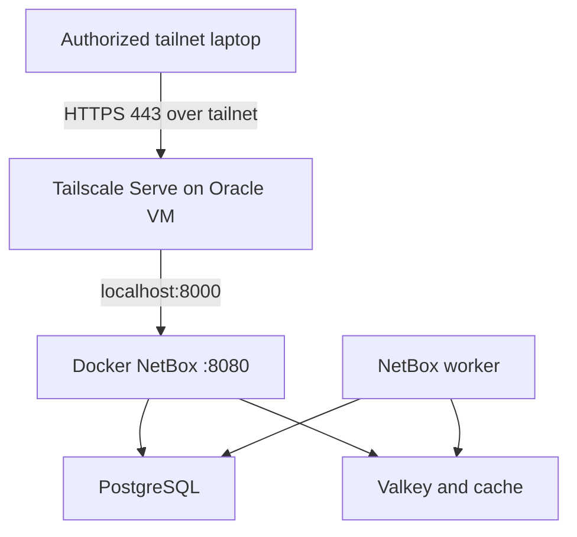

# Architecture

NetBox runs on an Oracle Cloud Ubuntu ARM64 VM, backed by official netbox-docker containers. The Docker host binding is restricted to `127.0.0.1:8000`, so HTTP cannot be reached over the OCI private or public VNIC or the tailnet IP directly.

Tailscale Serve handles TLS at the private `.ts.net` URL and proxies to the loopback-only HTTP endpoint. Funnel is deliberately disabled. SSH administration uses OpenSSH and SSH keys through the Tailscale IP; it is not the separate Tailscale SSH authorization feature.

Networking and application authorization are distinct trust boundaries. Tailscale authorizes overlay reachability; NetBox enforces login and object permissions.
