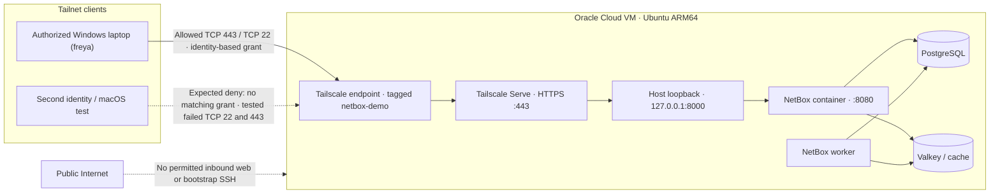

# Architecture and packet flow

The demo uses **one tailnet, two user identities, and three enrolled devices**: the authorized Windows laptop, an unauthorized macOS test device, and the Ubuntu NetBox VM. It uses native Tailscale Serve (not Funnel).

## HTTPS traffic flow

1. An authorized user's browser resolves the VM's `.ts.net` name and connects over the tailnet to **TCP/443**.
2. Identity-based Tailscale grants authorize network reachability to the VM's `tag:netbox-demo`.
3. **Tailscale Serve** terminates HTTPS and proxies locally to `http://127.0.0.1:8000`.
4. Docker maps host loopback TCP/8000 to NetBox container TCP/8080.
5. NetBox authenticates users and communicates with its internal PostgreSQL / Valkey services.

Administrative SSH is a *separate* TCP/22 connection using **OpenSSH keys over Tailscale**; it is not Tailscale SSH.

## Test interpretation

The authorized Windows client reached both TCP/22 and TCP/443. A second macOS client using an invited identity failed to connect to both ports. The operator confirmed the default allow-all grant was removed. These observations support the intended restricted design; detailed failure logs or packet traces were not captured, so do not present a failed TCP connection alone as definitive proof of the exact denial cause.

NetBox host TCP/8000 is bound to loopback: direct attempts from tailnet peers fail independent of grant rules. Funnel is disabled, keeping the site tailnet-only. TLS certificate hostnames are disclosed via certificate transparency, while application traffic remains private.
